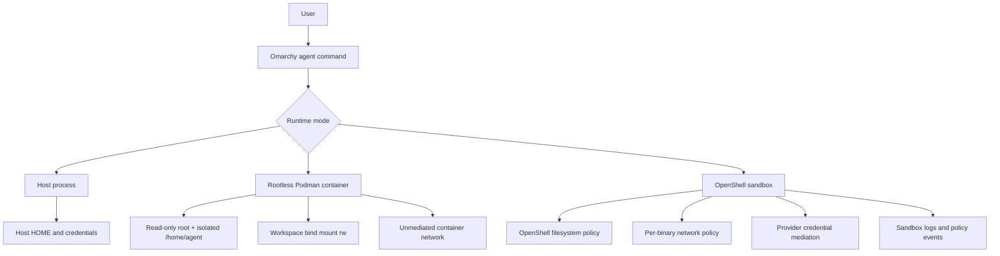
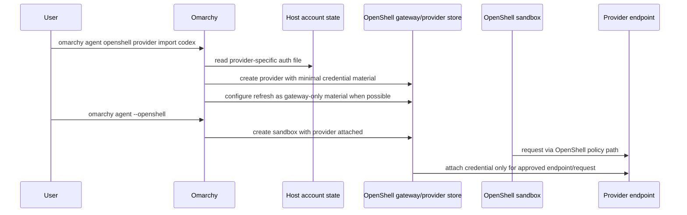
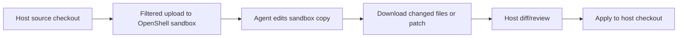
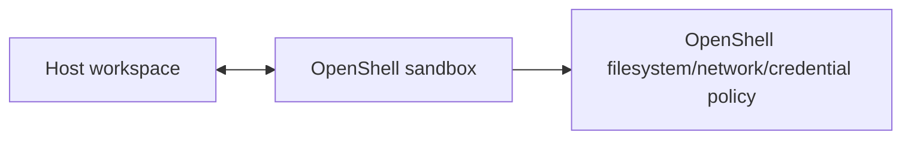

# Agent OpenShell Architecture

Omarchy currently supports host execution and hardened rootless Podman execution for coding agents. NVIDIA OpenShell is the target policy boundary for safer agent networking, credential mediation, and auditable sandbox execution.

This document describes the intended architecture before Omarchy makes OpenShell a first-class agent runtime.

## Importing the primary host Pi login

```bash
omarchy agent openshell provider import pi
omarchy agent openshell pi --provider pi-codex --model gpt-6.1-sol "Reply only OK"
```

The Pi importer reads `openai-codex` OAuth state from
`${PI_CODING_AGENT_DIR:-~/.pi/agent}/auth.json` (`PI_AUTH_FILE` can override the path).
It rejects expired credentials and stores only the access token and account ID in
OpenShell provider `pi-codex` (or `--name <name>`). Sandbox processes still receive
opaque handles, not raw credentials; no host auth directory is mounted.

This is a snapshot, not independent gateway refresh. Pi retains exclusive ownership
of its rotating refresh token: sharing it could invalidate the host login. Once
host Pi refreshes its login, update the snapshot with:

```bash
omarchy agent openshell provider import pi --force
```

Provider replacement may be blocked while sandboxes reference it. Do not delete
unrelated sandboxes to work around that. Automatic access-token synchronization is
future work. The older `import codex` path remains available and unchanged.

## Model catalog sync and doctor

```bash
omarchy agent openshell models sync                  # preview; no changes or model calls
omarchy agent openshell models sync --apply          # write user catalog
omarchy agent openshell models doctor                # offline schema/version/refresh checks
omarchy agent openshell models doctor --live --model gpt-6.1-sol
omarchy agent openshell models doctor --live         # test every catalog entry; consumes usage
```

Sync exports exact model metadata from the installed host Pi's `openai-codex`
catalog using a trusted metadata-only extension. It adds text-compatible GPT
candidates, retains catalog-only entries, and never changes the selected default.
Pi's catalog can include models unavailable to your account: additions are marked
unverified until live-tested. Sync does not remove models automatically.

The default output is `$XDG_CONFIG_HOME/omarchy/openshell/pi-models.json` (normally
`~/.config/omarchy/openshell/pi-models.json`). `--models-file <path>` selects an
existing alternate catalog for either command. Existing metadata overrides are
preserved on first sync. A companion `.pi-baseline.json` records upstream values;
subsequent syncs update fields unchanged since the last sync and preserve user
edits. Keep this baseline beside the catalog. Preview prints differences from Pi.

Doctor defaults to provider `pi-codex` (`--provider` overrides it). Offline checks
cannot prove token validity or model availability. Explicit `--live` runs tiny
no-tool requests through disposable OpenShell sandboxes, never through host Pi's
raw credentials. Repeat `--model` to limit probes. Authentication/access errors
stop the batch; unsupported models, rate limits, network failures and timeouts
are reported separately where recognizable. A timeout may leave sandbox cleanup
pending. Doctor never rewrites the catalog or refreshes credentials.

## Configuring Pi bridge models

The Pi bridge defaults to `gpt-6.1-sol`. Its bundled catalog is
`containers/harnesses/pi/extensions/openshell-codex-models.json`.
After building the catalog-aware image once (`omarchy harness build pi 1.3.0`),
model changes do not require another image rebuild:

```bash
mkdir -p ~/.config/omarchy/openshell
cp "$OMARCHY_PATH/containers/harnesses/pi/extensions/openshell-codex-models.json" \
  ~/.config/omarchy/openshell/pi-models.json
# Edit that JSON array to add or remove model definitions.
omarchy agent openshell pi --model gpt-6.1-sol "Hello"
# Alternatively choose a separate catalog:
omarchy agent openshell pi --models-file ./models.json --model gpt-6.1-sol "Hello"
```

Each entry requires a unique `id`, `name`, `reasoning` boolean, `input: ["text"]`,
positive integer `contextWindow` and `maxTokens`, and nonnegative `cost` fields
(`input`, `output`, `cacheRead`, `cacheWrite`). The bridge is currently text-only.
Bundled model limits follow Pi 1.3.0 metadata; zero costs mean unknown,
not free. The catalog includes `gpt-6.1-sol`, `gpt-6-sol`, `gpt-6-luna`,
`gpt-6-astra`, `gpt-5.6-sol`, `gpt-5.6-terra`, and `gpt-5.6-luna`.
All passed host account smoke tests. `gpt-5.5`, `gpt-5.3-codex-spark`,
and `gpt-6.1-terra` were rejected and are not bundled. Use verified metadata when adding entries. Catalog metadata is passed
as a non-secret environment variable; host config and auth directories are not mounted.
Adding a model does not grant account access. `gpt-6.1-sol` passed a host account
test; `gpt-6.1-terra` was rejected, so it is not bundled. OpenShell credentials
must independently be valid. HTTP failures now produce errors rather than empty success.

## Goals

- Keep host execution available, but explicit.
- Keep Podman execution as a local filesystem/process isolation baseline.
- Add OpenShell as the preferred policy-controlled runtime once the credential and workspace workflows are safe.
- Never bind-mount host account directories or arbitrary host home paths into an agent sandbox.
- Make runtime, network, credential, and workspace state visible to users.
- Fail closed when a requested OpenShell control is unavailable.

## Non-goals

- OpenShell does not eliminate prompt injection risk.
- OpenShell is not a replacement for task review, diffs, or user approval.
- Omarchy should not silently translate direct host account state into sandbox access without a provider-specific broker/importer.

## Runtime layers



## Runtime comparison

| Runtime | Filesystem isolation | Network control | Credential model | Intended use |
|---|---|---|---|---|
| `host` | None | Host network | Host account state | Explicit escape hatch, crash diagnosis, trusted local work |
| `podman` | Read-only root, isolated agent home, workspace rw | Coarse/unmediated | Account volumes or env if configured | Safer default baseline before OpenShell integration |
| `openshell` | Policy-enforced sandbox filesystem | Per-binary and request-aware policy | Provider-mediated credentials | Preferred future runtime for autonomous agents |

## Desired command model

```bash
omarchy agent --host
omarchy agent --container
omarchy agent --openshell

omarchy agent prompt --oneshot "..."
omarchy agent prompt --container --oneshot "..."
omarchy agent prompt --openshell --oneshot "..."

omarchy agent openshell doctor
omarchy agent openshell install
omarchy agent openshell provider import <provider>
omarchy agent openshell prompt --provider <provider> "smoke prompt"
```

OpenShell mode should be explicit until all major account and workspace flows are implemented. The current `openshell prompt` command is only a provider/sandbox smoke test: it verifies credential environment presence without printing values and echoes the prompt. It is not yet a full LLM agent runtime.

## OpenShell local installation

On Omarchy, OpenShell is installed user-locally rather than through deb/rpm packages:

```text
~/.local/bin/openshell
~/.local/bin/openshell-prover
~/.local/bin/openshell-gateway
~/.local/state/openshell/
~/.config/openshell/gateways/openshell/mtls/
~/.config/systemd/user/openshell-gateway.service
```

The local gateway uses rootless Podman through the Podman user socket:

```bash
systemctl --user enable --now podman.socket
systemctl --user enable --now openshell-gateway.service
```

## Credential architecture

### Problem

Many coding agents are not configured with simple API keys. They use direct account state from host CLI directories, browser/device-flow logins, refresh tokens, account IDs, or opaque local auth files.

Examples include:

- `~/.codex/auth.json`
- Claude/Codex/Grok account directories
- provider CLIs with OAuth refresh state
- GitHub/GitLab credential helpers

Mounting those directories into an OpenShell sandbox would expose broad host credentials and defeat the security boundary.

### Required pattern

Credential handling must use provider-specific importers or brokers:



Rules:

- Do not bind-mount host account directories into OpenShell sandboxes.
- Do not pass refresh tokens as sandbox environment variables.
- Prefer gateway-only refresh material when supported.
- Expose provider names and credential keys in status, never values.
- If a provider cannot be safely imported, OpenShell mode must fail or require an explicit unsafe override.

## Provider support matrix

Initial implementation should track provider support explicitly.

| Provider/agent | Host account source | OpenShell strategy | Status |
|---|---|---|---|
| Codex | `~/.codex/auth.json` | Import access token/account ID; store refresh token as gateway-only refresh material | Prototype implemented |
| OpenRouter/OpenAI-style API keys | Environment or account config | OpenShell provider profile with static credential binding | Supported once profile exists |
| Pi | Depends on configured model/provider | Use provider profile; avoid host home secrets | Needs provider mapping |
| Claude account login | Local CLI account state | Needs provider-specific importer/broker | Not safe by default |
| GitHub | token/gh auth/git credential helper | Provider import or scoped token broker | Needs design |

## Workspace architecture

OpenShell workspace handling is the other major design decision.

### Option A: upload/download workspace



Pros:

- Stronger host filesystem isolation.
- No direct writable host mount.
- Better for managed task workspaces.

Cons:

- Needs reliable diff/download workflow.
- Interactive edit loops are less direct.

### Option B: direct workspace mount



Pros:

- Matches current coding-agent workflow.
- Direct edits appear in the host checkout.

Cons:

- Larger blast radius if filesystem policy is wrong.
- Requires careful OpenShell support and verification.

Initial recommendation: use upload/download for managed tasks and one-shot experiments; only add direct writable workspace mounts after policy evidence is visible in `doctor`/`audit`.

## Network architecture

OpenShell network policy should be default-deny. Omarchy should surface:

- selected sandbox policy
- provider-contributed rules
- pending policy proposals
- denied destinations
- approval mode: `manual` vs `auto`

Initial policies should allow only the model/provider endpoints required by the selected agent. Package registries, Git hosts, MCP servers, and arbitrary web access should be added explicitly through proposals or user-approved policy files.

## Audit/status UI

`omarchy agent policy`, `omarchy agent audit`, and future runtime UI should report:

```text
Runtime:       host | podman | openshell
OpenShell:     not-installed | installed | gateway-reachable | sandbox-smoke-passed
Gateway:       openshell https://127.0.0.1:17670
Filesystem:   workspace mode, home isolation, root policy
Network:      unmediated | openshell-policy:<name>
Credentials:  none | provider:<name> keys:<names hidden values>
Approval:     manual | auto
Audit:        latest sandbox policy/log evidence
```

## Migration stages

### Stage 0: Visibility

Done/in progress:

- OpenShell installer.
- OpenShell doctor.
- Policy/audit status exposure.

### Stage 1: Provider import prototypes

Done for Codex:

- `omarchy agent openshell provider import codex` imports from `~/.codex/auth.json`.
- Credential values are never printed.
- Refresh material is configured as OpenShell gateway refresh material.

Still needed:

- Verify provider list/status without printing secrets.
- Document unsupported direct-account providers.

### Stage 2: One-shot sandbox proof

Started:

- `omarchy agent openshell prompt --provider codex "..."` creates a disposable OpenShell sandbox, attaches the imported Codex provider, checks that credential environment variables are present without printing values, and echoes the prompt.

Still needed:

- Add `omarchy agent prompt --openshell --oneshot` for one real agent/provider pair.
- Prefer upload/download or no-workspace smoke prompts.
- Capture policy and logs.

### Stage 3: Managed task integration

- Create OpenShell sandbox per assignment.
- Upload assignment workspace or mount only managed workspace.
- Export patch/diff back to assignment workspace.

### Stage 4: Interactive sessions

- Add interactive OpenShell agent sessions only after credential and workspace safety is validated.
- Keep host mode explicit.

### Stage 5: Preferred/default policy

- Consider `openshell` as preferred when provider support and workspace workflow are complete.
- Keep Podman fallback explicit and visible.

## Open questions

- Which providers can be safely imported today without exposing refresh tokens to the sandbox?
- Does OpenShell support a direct writable workspace mount with enough evidence for Omarchy audit?
- Should OpenShell mode use one sandbox per prompt, per session, or per assignment?
- How should Omarchy represent pending OpenShell policy proposals in the UI?
- How should provider profiles be installed/updated for Omarchy-managed agents?
- How do we migrate existing Omarchy account pins into provider records without leaking secrets?
