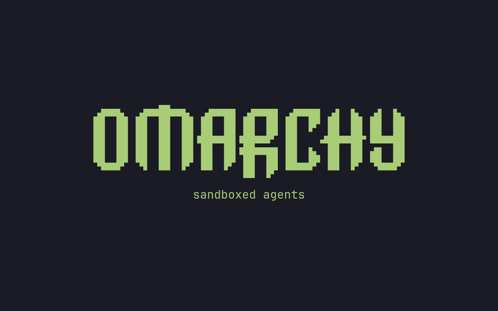
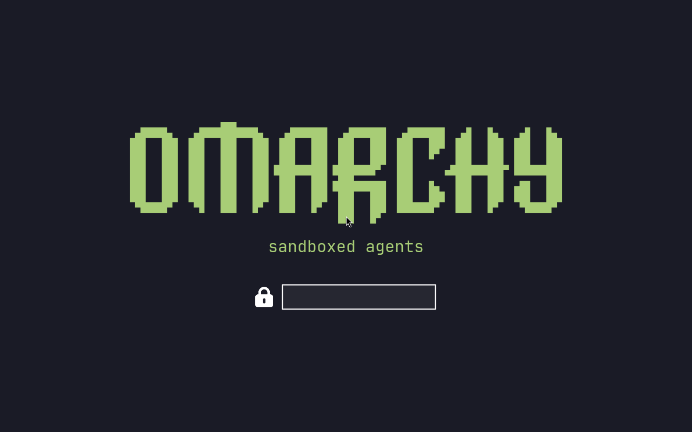

# Branding

Omarchy allows you to set your company logo or personal image for both the boot unlock, the screensaver, and the about screen.

### Fork branding: sandboxed agents

This fork supplies the Omarchy wordmark with a smaller **sandboxed agents** subtitle. The boot and login screens use a PNG image. The screensaver uses the existing text wordmark with a centered subtitle. The stock defaults remain separate.

The following captures show the boot splash and login screen in a disposable VM:





Installing Omarchy, cloning this fork, and running `omarchy dev link` does not install this branding. Link/unlink does not rebuild boot images. To opt in:

1. Start with a packaged Omarchy release compatible with this fork.
2. Clone the fork:

   ```bash
   git clone --branch quattro https://github.com/kecol/omarchy.git ~/omarchy-fork
   ```

3. Link the checkout:

   ```bash
   omarchy dev link ~/omarchy-fork
   ```

4. Accept the reboot prompt and log in again. If you decline the prompt, reboot before continuing so the command environment uses the checkout.
5. Run one of the following commands as your user, not under sudo.

**Screensaver only, without a boot-image rebuild:**

```bash
omarchy branding apply --screensaver-only
```

The command backs up changed screensaver text next to `~/.config/omarchy/branding/screensaver.txt` as `screensaver.txt.bak.<unique-suffix>`. It does not start the screensaver or change idle settings. Use _System > Screensaver_ to view it.

**Boot, login, and screensaver:**

Do not rebuild boot images on a machine with unresolved filesystem checksum errors. Investigate those errors first. Use `--screensaver-only` while boot-image changes are deferred.

The following command replaces the current boot/login theme with the fork logo, a `#1a1b26` background, and white unlock controls. It changes system-wide boot/login assets and only the current user's screensaver. It backs up changed screensaver text, but **does not save a previous custom boot/login theme**. Preserve any custom logo and colors separately before continuing.

```bash
omarchy branding apply
```

Confirm the prompt. The command delegates privileged work to the existing Plymouth publisher, which updates the boot and SDDM login assets and rebuilds boot images. It does not reboot automatically. The new boot logo appears on the next boot. Repeating the full command rebuilds boot images again, even if the screensaver text is unchanged.

If the boot helper fails, the command leaves the screensaver unchanged and reports failure. System boot/login assets may already have changed. There is no automatic rollback across boot-image generation and asset publication. Resolve the reported error before rebooting.

**Before unlinking:**

```bash
omarchy branding restore
omarchy dev unlink
```

Confirm the restore and wait for its boot-image rebuild to succeed before unlinking. Restore selects the stock boot/login defaults shipped by the checkout and its stock screensaver text. It does not recover earlier custom boot/login branding. It backs up changed screensaver text; to recover earlier custom text, copy the named backup over `~/.config/omarchy/branding/screensaver.txt`. Use `omarchy branding restore --screensaver-only` to restore text without touching boot/login assets.

If you already unlinked and rebooted into packaged Omarchy, use the packaged commands `omarchy plymouth reset` and `omarchy branding screensaver reset`. The latter opens the screensaver. Boot reset rebuilds boot images and requires administrator access. The fork's apply/restore commands are not available from the packaged command tree.

The branding is a persistent visual label, not a runtime check or a security guarantee. If you unlink without restoring, the fork logo remains until you replace it. Check `$OMARCHY_PATH` to identify the active source tree.

### Boot unlock

You can use `omarchy plymouth preview` to see what your custom logo and colors would look like. It takes a background color, a text color, a logo png, and a path for the preview image:

```
omarchy plymouth preview '#1d2021' '#ebdbb2' logo.png preview.png
```

Then apply the setup with `omarchy plymouth set '#1d2021' '#ebdbb2' logo.png`, which will also give the SDDM login screen the same colors and logo. If you want to revert, you can use `omarchy plymouth reset`.

 

### Screensaver

You can change the logo used for the screensaver under _Appearance > Branding > Screensaver_. It's an ASCII logo, so you can edit the text directly, but you can also hand it a png or svg image, and we'll convert that to ASCII. It looks pretty cool.

 

There are three entries in that menu:

- **Edit Text** opens `~/.config/omarchy/branding/screensaver.txt` in your editor. Type or paste whatever you like — ASCII art, your name, a rude word. Save and quit, and the screensaver fires up immediately so you can see it.
- **Set From Image** opens a file picker for a png or svg, converts it to ASCII, and shows you the result. Logos with a clear silhouette work far better than photos.
- **Restore Default** puts the Omarchy logo back.

### About screen

The same three options are under _Appearance > Branding > About_ for the _About_ screen you get from the Omarchy menu, and they work identically — the file is `~/.config/omarchy/branding/about.txt`, and the About window pops up after each change. The About art is converted to a smaller size than the screensaver's, since it has to fit in a window rather than fill your display.

While the window is open a glint of green leans across the art every few seconds and then leaves it still again. Your own art gets it too, as long as every character in it is one column wide — anything _Set From Image_ produces is. Art built from emoji or double-width characters stays still instead, and so does the screen if you keep a fastfetch config of your own: a still logo in those cases is the animation keeping out of the way rather than failing, since sliding a glint across them would land the rest of the line in the wrong place.

 

### Converting images yourself

Both of the _Set From Image_ options are just calling `omarchy transcode ascii`, which you can run directly if you want control over the conversion:

```
omarchy transcode ascii ~/logo.svg ~/.config/omarchy/branding/screensaver.txt --width 100
```

It takes `--width` and `--height` in terminal columns and rows, a `--mode` of either `braille` (the default, and much finer) or `block`, a `--threshold` percentage for deciding which pixels count as part of the logo, and `--invert` for when your logo is light on a dark background. If a conversion comes out as a blob, the threshold is usually the knob to turn.

### Words instead of a logo

`omarchy ascii` draws text in Delta Corps Priest 1, the FIGlet font the Omarchy wordmark itself is drawn in, so a screensaver can say something rather than show a picture:

```
omarchy ascii "Back in five" > ~/.config/omarchy/branding/screensaver.txt
```

It takes the text as arguments, or reads it from a pipe when given none. The font carries letters and spaces only — it was drawn without digits or punctuation — so anything else is dropped and named on stderr rather than quietly swallowed.
